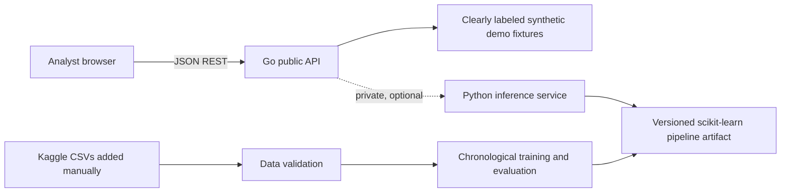

# VerityFlow AI

**Every financial risk, connected to its evidence.**

An explainable financial transaction-fraud investigation workspace for the BFSI challenge. The intended modeling dataset is Kaggle's **simulated US credit-card transaction** dataset—not real banking data and not an MSME lending dataset. The product separates transaction fields, model estimates, and deterministic rule findings; an alert is not proof of fraud.

> **Current state:** The workspace runs in clearly labeled synthetic demo mode with 72 fictional transaction fixtures. No Kaggle files, fitted model, or Kaggle evaluation metrics are present. The evidence-first case workflow and Gemini SDK integration are implemented, but no Gemini credential is configured for a live call. No Cloud Run deployment has been performed.

## Features

- Responsive investigation dashboard with transaction activity, risk-band and category charts, filters, pagination, and transaction detail drawer.
- Go REST API with JSON errors, CORS allowlisting, input validation, request limits, security headers, timeouts, and graceful shutdown.
- Separate, private Python model-inference service contract; unavailable models return explicit errors rather than invented predictions.
- Reproducible Python pipeline: data checks, leakage-aware features, chronological holdout, logistic and tree-based model comparison, saved metrics and versioned artifact.
- Deterministic demo rules show evidence and review thresholds; not proof or operational policy.
- Evidence-first case workflow with evidence ledger, backend Gemini function-calling integration, validated finding citations, deterministic fallback, case comparison, analyst-confirmed actions, in-process audit events, and report digest.
- Fixed-set API workflow harness checks demo evidence references, fallback behavior, invalid transaction handling, comparison, and latency; unsupported-claim review and live Gemini tool selection are not yet measured.
- Raw CSVs, generated profiles, and model artifacts are Git-ignored.

## Architecture

The browser calls the Go API only. Python inference should be reachable only over a private service network, never exposed as the public API. In the current demo topology the inference service is optional and reports model unavailability until a valid saved artifact exists.

The baseline inspection and prioritized delivery checklist are in [docs/technical-audit.md](docs/technical-audit.md). The Gemini integration uses only fixed, allowlisted Go read tools scoped to the selected synthetic transaction and its rule findings. Agent output is rejected to a deterministic fallback if its evidence IDs do not match the ledger.

## Technology

React, Vite, TypeScript, Tailwind CSS, React Router, Recharts; Go `net/http`; Google's official `google.golang.org/genai` SDK; Python 3.11, pandas, NumPy, scikit-learn, joblib; Docker Compose.

## Local prerequisites

- Node.js 20+ and npm
- Go 1.22+
- Docker Desktop and Compose plugin (only for container startup)

The deterministic frontend/backend demo needs no Python installation, Kaggle data, trained model, or credentials. Gemini/Vertex credentials are optional; investigations use the deterministic fallback when they are not configured.

## Start locally

1. Start the Go API in one terminal: `cd backend` then `go run ./cmd/api` (default port `8080`).
2. Start the frontend in another terminal: `cd frontend`, `npm install`, then `npm run dev` (Vite prints its local URL, normally port `5173`). The Vite dev server proxies API calls to Go.
3. The API serves 72 in-memory synthetic scenarios and keeps investigation cases in memory. All records and risk estimates are fictional demo fixtures, not measured fraud or model predictions.

Alternatively, run `docker compose up --build` from the repository root and open `http://localhost:5173`. Compose starts only the Go API and frontend; it does not build or start anything under `ml/`. The model-evaluation page explicitly reports that trained metrics are not part of this demo. For optional live Gemini investigations, configure a local ignored `.env` with a Gemini key, or configure Vertex AI ADC and the project/location variables.

## Dataset access and validation

Dataset source: [Kaggle: kartik2112/fraud-detection](https://www.kaggle.com/datasets/kartik2112/fraud-detection). Review the source's terms and obtain the CSVs yourself. Do not commit them.

Place files at:

- `ml/data/raw/fraudTrain.csv` (labeled training set)
- `ml/data/raw/fraudTest.csv` (test labels are not assumed to exist)

Optional download requires your own configured Kaggle CLI and explicit authorization: `./scripts/download_kaggle.ps1`. This script does not request or store credentials. Validate data with `python ml/src/validate_data.py`. The generated profile reports columns, missing values, duplicate transaction IDs, malformed timestamps/amounts/labels, and labeled fraud prevalence.

CSV columns expected from this dataset include timestamp, `cc_num`, merchant, category, amount, gender, city/state/ZIP, coordinates, population, job, date of birth, transaction ID, Unix time, merchant coordinates, and (for training) `is_fraud`. Raw identifiers and personal fields are excluded from the model and not shown in the dashboard. Do not infer test metrics without valid target labels.

## ML commands

Run in repository root after placing data:

- `python -m pip install -r ml/requirements.txt`
- `python ml/src/validate_data.py`
- `python ml/src/train.py` (chronological holdout; writes ignored artifacts under `ml/artifacts/`)
- `python ml/src/evaluate.py` (reads saved evaluation JSON)
- `python ml/src/export_model.py` (model artifact smoke test)
- `python -m pytest ml/tests -q`
- Convenience targets: `make data-check`, `make train`, `make evaluate`, and `make test` (GNU Make required).

ML evaluation reporting note: the current trainer selects model and threshold from the same chronological 20% validation segment whose performance it reports. Treat these metrics as validation/tuning results, not an untouched final-test estimate; before operational interpretation, revise to use a separate later chronological test window or nested rolling-origin evaluation.

The pipeline compares class-weighted logistic regression with histogram gradient boosting trained using balanced sample weights; selects by holdout PR-AUC, then F1; and chooses a review threshold by validation F1 among documented score quantiles. This retrospective choice is not a production operating policy. Inspect every report and assess false-positive workload, false negatives, subgroup impacts, and temporal drift before any use. No evaluation has run on the absent Kaggle data, so **actual ML metrics are not yet available**.

Features: merchant category, merchant, state, timestamp-derived hour/day/weekend/time period, log amount, log city population, and approximate card-to-merchant geodesic distance. Excluded: card/transaction identifiers, names, street, ZIP, date of birth, occupation, gender, target, and raw Unix time. Evaluate geographic features and synthetic correlations for leakage, fairness, validity, and drift before use.

## API

Default Go API origin: `http://localhost:8080`.

| Method | Path                                                                                                 | Description                                                                             |
| ------ | ---------------------------------------------------------------------------------------------------- | --------------------------------------------------------------------------------------- |
| GET    | `/health`                                                                                            | API health and explicit demo/model status                                               |
| GET    | `/api/v1/config`                                                                                     | Mode and documented demo thresholds                                                     |
| GET    | `/api/v1/overview`                                                                                   | Filterable current fixture counts and amount totals                                     |
| GET    | `/api/v1/transactions?page=1&page_size=20&q=...&category=...&risk=...&min_amount=...&max_amount=...` | Search/filter/paginate synthetic records (max 100/page)                                 |
| GET    | `/api/v1/transactions/{id}`                                                                          | Fixture details and deterministic findings                                              |
| POST   | `/api/v1/predict`                                                                                    | Validates request; currently returns `503 model_unavailable` rather than fake inference |
| GET    | `/api/v1/model/metrics`                                                                              | Saved evaluation metrics, or explicit `503` when unavailable                            |
| GET    | `/api/v1/analytics/fraud-trends`                                                                     | Fixture counts by day (not model evaluation)                                            |
| GET    | `/api/v1/analytics/categories`                                                                       | Fixture summary by merchant category                                                    |
| POST   | `/api/v1/transactions/{id}/investigate`                                                              | Bounded Gemini tool-calling investigation or explicit deterministic fallback            |
| GET    | `/api/v1/transactions/{id}/compare?with_id=...`                                                      | Compare two existing demo records and disclose fixture limitations                      |
| GET    | `/api/v1/cases`                                                                                      | List in-memory synthetic investigation cases                                            |
| GET    | `/api/v1/cases/{id}`                                                                                 | Read linked transaction, evidence ledger, and case events                               |
| GET    | `/api/v1/cases/{id}/audit`                                                                           | Read process-local audit events (not tamper-proof)                                      |
| POST   | `/api/v1/cases/{id}/actions`                                                                         | Append analyst status/rationale only with `confirmed: true`                             |
| POST   | `/api/v1/cases/{id}/report`                                                                          | Generate an evidence-linked report and content digest                                   |

Set `PORT`, `CORS_ORIGINS` (comma-separated exact origins), `GEMINI_MODEL`, `GOOGLE_API_KEY` or Vertex AI ADC variables, and `VITE_API_BASE_URL` through environment configuration. `INFERENCE_URL` and `EVALUATION_PATH` are optional integrations and are not configured by the demo. See [.env.example](.env.example). Never commit secrets. This MVP has no analyst authentication; restrict access to the synthetic demo.

## Tests and quality checks

- Go: `(cd backend && go test ./...)`
- Python: `python -m pytest ml/tests -q`
- Frontend: `(cd frontend && npm install && npm run lint && npm run build)`
- Live API smoke (after starting Go): `./scripts/smoke.ps1` in PowerShell
- Compose: `docker compose up --build`, then run the smoke script.

Go tests passed after the agent workflow changes, including fallback evidence references, missing transaction handling, confirmation gating, audit retrieval, and report generation. The six ML tests passed; the ML source itself was not changed for this upgrade. Run `npm run lint` and `npm run build` from `frontend/` after the latest edits; earlier lint detected and led to correction of a misplaced evidence details block. No Kaggle ML metrics are available. `gcloud` and Docker were unavailable, so deployment/container verification was not performed. Use `scripts/evaluate_agent.ps1` against a running API; its measures are synthetic-demo checks, not a production benchmark.

## Deployment

Cloud Run preparation is in [deploy/cloud-run.md](deploy/cloud-run.md). The Go API binds to `PORT`, runs non-root, and has health/readiness routes. The API can use Gemini Developer API or Vertex AI ADC through the official Go SDK. The Python inference service remains private. A live deployment was not attempted: `gcloud`, project selection, and deployment permissions were unavailable. Because this MVP has no authentication, do not expose it publicly or connect real/sensitive transaction data until identity verification and case authorization are implemented.

## Safeguards and limitations

This is educational investigation support, not a production fraud-control system. The source data is simulated; patterns can be artificial and unrepresentative. Fraud imbalance, temporal drift, false positives/negatives, geographic and category proxies, subgroup bias, calibration, and threshold operational costs require careful assessment. No model proves fraud; never use this output for lending, account freezing, legal decisions, or adverse action. Avoid unnecessary retention of data and keep all secrets, data, and artifacts out of Git.

Gemini SDK function-calling integration is implemented, but no live call was verified because credentials are absent. The allowed tools only retrieve the selected transaction and deterministic rule findings; the agent cannot write analyst actions. The case store is in-memory, lost on restart, and not tamper-proof. Evaluation can provide global permutation importance, but no local attribution is generated. Rule findings are review leads. Model metrics and predictions for Kaggle remain unavailable until authorized data is supplied and trained.

## Demo flow (3 minutes)

1. **0:00–0:25 — Provenance:** show the demo banner and explain the fixtures are fictional; the intended Kaggle source is simulated card transactions.
2. **0:25–1:05 — Overview:** review scenario volume, high-risk bands, activity trend, and category chart; point out all values are demo-generated, not measured fraud prevalence.
3. **1:05–1:50 — Explorer:** search an ID/merchant, filter by category, risk, and amount, sort by the demo estimate, and page through results.
4. **1:50–2:35 — Investigation:** open a high-risk scenario; separate observed fields, illustrative score, threshold-based rule evidence, and follow-up checks. State that an alert is not proof.
5. **2:35–3:00 — Evaluation/methodology:** show that metrics are unavailable until real authorized CSVs are supplied and training succeeds; review safeguards and limitations.

## Screenshots

Capture current app screenshots after locally running the UI: overview dashboard, filtered transaction explorer, investigation details drawer, model-unavailable evaluation state, and methodology safeguards. No screenshots are committed because no browser/runtime validation has yet been performed.

## License

No project license is included: confirm rights and terms for all code/data before assigning a license. Kaggle dataset terms do not automatically grant rights to this project.
