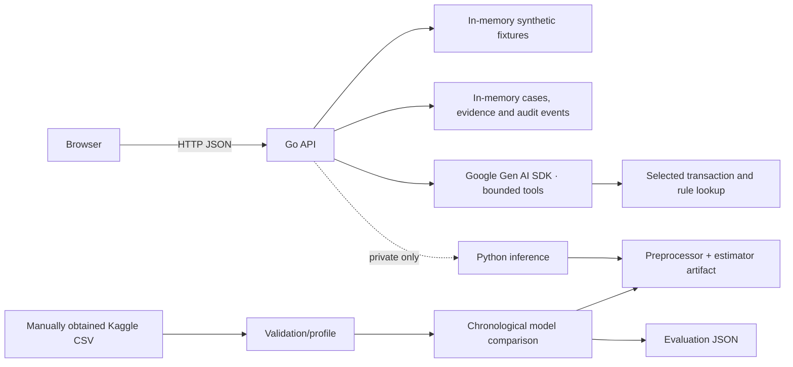

# Architecture

## Trust boundaries

- Browser calls only the Go public REST API.
- Go API validates/limits input, emits structured errors and avoids logging transaction values.
- Gemini is called server-side through Google's official Go SDK. Its tool allowlist can read only the selected fixture transaction and deterministic findings; agent tools cannot record analyst actions.
- Analyst writes require explicit confirmation and are appended to an in-memory case event history. This is not durable, tamper-proof audit storage and must not hold real customer records.
- Python model inference is a private optional service; its artifact is mounted read-only and model/schema errors fail closed.
- Current data source is clearly labeled fictional demo fixtures; real CSVs are local and ignored by Git.

## Runtime behavior

The API exposes health/readiness, config, overview, filtered/paginated transactions, transaction details, prediction, saved metrics, trend/category analytics, investigations, comparisons, cases, audit events, actions, and reports. Demo records are reproducible fixtures; overview and charts describe those fixtures only. `/predict` and model metrics return unavailable errors until an actual trained model service/artifact exists. A missing or incompatible model never falls back to a fake score.

The investigation endpoint creates structured evidence (observed demo fields, deterministic rule evidence, and a separately marked illustrative UI score). With credentials and reachable Google AI, Gemini uses a maximum-four-call tool loop with an 18-second deadline; the only functions are scoped transaction details and triggered rule findings. Model-generated findings must reference evidence IDs returned by the tools. Malformed or unsupported references cause a deterministic fallback. Without Gemini credentials, the API explicitly returns the deterministic fallback and never claims Gemini executed.

Cases, evidence and audit events are process-local demo state. Restarting Go clears them. The case report digest is a content hash, not a signature or tamper-proof audit guarantee. The application has no analyst authentication or authorization; keep the service private.

## ML

Training loads labeled rows, drops malformed rows, sorts by parsed transaction time, and uses a chronological 80/20 split within a capped recent history. A fitted sklearn `Pipeline` stores categorical encoders, imputers/scaler where applicable, and estimator. Feature construction is shared by train and inference. Metrics are saved as JSON without persisting validation transaction examples. Artifact schema/version/threshold are checked by inference.

## Safeguards

Data profiles may include local missingness counts, but no raw dataset is committed. UI omits direct identifiers and PII. Rules expose their thresholds and evidence. Demo scores are not probability estimates; threshold bands serve UI illustration only.
